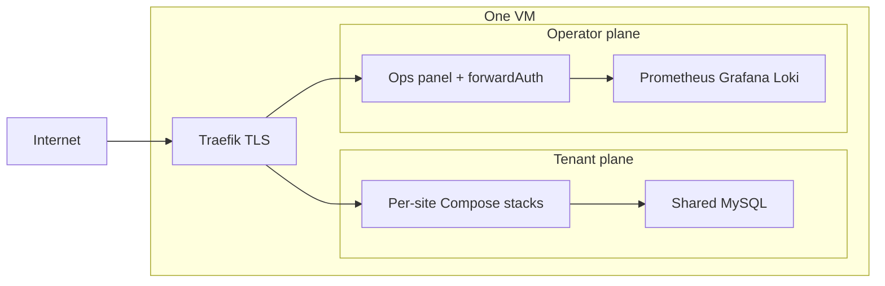

# single-vm-web-platform

**A multi-tenant edge on one Debian VM.** Isolated site stacks, a locked operator plane, and infrastructure you can rebuild from zero with two commands.

[](https://github.com/cha0skvlt/single-vm-web-platform/actions/workflows/ci.yml)
[](terraform/)
[](docs/openstack.md)
[](terraform/examples/selectel.tfvars.example)
[](ansible/)
[](app/docker-compose.yml)
[](app/docker-compose.yml)
[](app/docker-compose.yml)
[](app/docker-compose.yml)
[](app/docker-compose.yml)
[](app/docker-compose.yml)
[](terraform/examples/selectel.tfvars.example)
[](pyproject.toml)
[](LICENSE)

This is the class of platform I deploy and operate for paying clients — many HTTPS properties, one blast radius, one operator. Source-available under PolyForm Shield 1.0.0: personal and in-house use is fine, reselling the platform as a product or competing service sits outside the license. Hiring or a custom rollout: [Eugene Grossbart / piniq.ai](https://piniq.ai).

---

## Design

One VM, three planes, explicit boundaries. Terraform builds the cloud shape, Ansible shapes the host, Compose runs the platform. Every layer is a directory you can read in one sitting, and the whole stack rebuilds from an empty project with `make bootstrap`.



| Plane | Path | Owns |
| --- | --- | --- |
| Cloud | `terraform/` | Network, VM, floating IP, SSH key |
| Host | `ansible/` | OS, UFW, Docker, fail2ban, stack rsync |
| Platform | `app/` | Traefik, MySQL, observability, ops panel, sites |

Tenant containers run on `web`; the operator plane runs on `platform`; databases share `db`. Traefik reaches the Docker API through `docker-socket-proxy`. Site CD is scoped to one FQDN, while Terraform and Ansible stay with the operator.

## What's inside

| Capability | Implementation |
| --- | --- |
| Cloud | `terraform-provider-openstack` 2.1.0, generic module, Selectel VPC profile included |
| TLS termination | Traefik v3, ACME/Let's Encrypt per router, purchased PEMs supported |
| Tenant isolation | One Compose project per FQDN, separate `web` / `platform` / `db` networks |
| Shared database | MySQL 8.4 with per-site users, provisioned by `db-provision.sh` |
| Operator plane | Zero-dependency Python panel, form login, `forwardAuth` in front of Grafana, the Traefik dashboard, and phpMyAdmin |
| Metrics | Prometheus v3 scraping Traefik, node-exporter, Docker, mysqld-exporter, and site exporters |
| Logs | Alloy shipping container logs, journald, and fail2ban into Loki 3 |
| Dashboards | Grafana 11, provisioned folder **Platform** |
| Host hardening | UFW, fail2ban, SSH key-only, cloud-init first boot |
| Delivery | GitHub Actions run tests and validation; deployment runs from the operator's machine |

## Quickstart

Lab walkthrough — the fastest path from an empty Selectel project to a live panel.

```bash
cp terraform/examples/selectel.tfvars.example terraform/terraform.tfvars
# fill user_domain_name, project_id, username, password
make bootstrap
```

Key → `.env` → apply (local state) → inventory → SSH → Ansible. Point `PROD_PUBLIC_HOST` at the floating IP, then open `https://<PROD_PUBLIC_HOST>` — Traefik matches the Host header and Let's Encrypt issues for DNS names. Teardown: `terraform -chdir=terraform destroy`.

Other OpenStack clouds: `terraform/examples/generic.tfvars.example`. [Getting started](docs/getting-started.md) · [OpenStack module](docs/openstack.md).

## Make targets

| Target | Role |
| --- | --- |
| `make bootstrap` | Lab: key → apply → Ansible |
| `make deploy` | Ansible (code only; keeps the server `.env`) |
| `make test-full` | Unit + service tests |
| `make fmt` / `make validate` | Terraform |
| `make site-add` | Scaffold a new tenant from `_example*` |
| `make site-rm DOMAIN=… FORCE=1` | Remove a tenant |

Workloads (after the platform is up): [sites.md](docs/sites.md). Operator-only helpers: `deploy-ci`, `smoke`, `doctor`.

## Docs

| Document | Contents |
| --- | --- |
| [Getting started](docs/getting-started.md) | Selectel lab, bootstrap, DNS, teardown |
| [OpenStack module](docs/openstack.md) | Provider, resources, variables, Selectel profile, state |
| [Architecture](docs/architecture.md) | Layers, networks, TLS, observability, secrets |
| [Sites](docs/sites.md) | Add, ship, and remove a tenant |

## Repository layout

```
terraform/   cloud: network, VM, floating IP, SSH key
ansible/     host: OS, UFW, Docker, fail2ban, stack rsync
app/         platform: Traefik, MySQL, observability, ops panel, sites
docs/        getting started, OpenStack module, architecture, sites
scripts/     bootstrap, deploy, certs, inventory, diagnostics
tests/       unit + service (compose, ansible, terraform, shellcheck)
```

`keys/deploy.pub` is a placeholder so `terraform validate` works on a fresh clone. `make bootstrap` replaces it with a key you own.

## Requirements

- Terraform >= 1.10, Ansible core >= 2.15, Python >= 3.9
- Docker + Compose v2 on the target VM (installed by Ansible)
- An OpenStack project (Selectel VPC profile included) and a domain you control

## Security

Secrets stay out of git: `app/.env`, `terraform.tfvars`, state files, private keys, and PEMs are gitignored, and CI runs gitleaks on every push. Report a leak or a vulnerability privately to the repository owner rather than in a public issue.

## Status

Reference sample, maintained as a portfolio piece. Issues and PRs that fix sanitization leaks, tests, or docs are welcome — see [CONTRIBUTING.md](CONTRIBUTING.md).

## License

[PolyForm Shield 1.0.0](LICENSE). Source-available portfolio sample. Personal and in-house use is fine; selling this platform as a product or competing service sits outside the license. Hiring or a custom rollout: [piniq.ai](https://piniq.ai).
